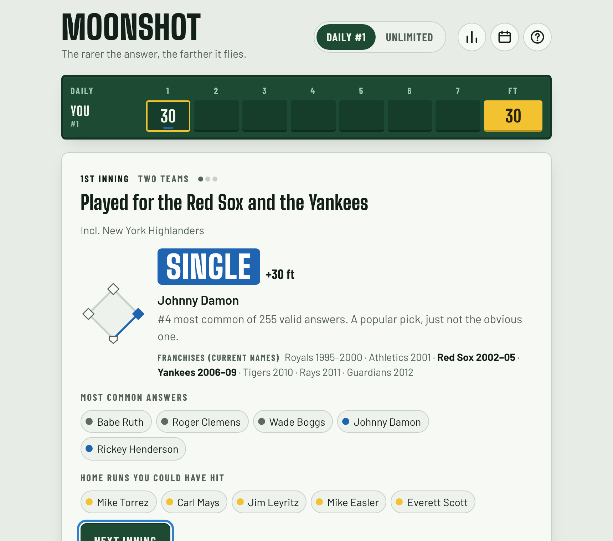

# Moonshot

A daily baseball trivia game with Krillion's structure and Immaculate Grid–style prompts. It has seven innings, each with one prompt and one answer. Name any MLB player who fits, but the rarer your correct answer, the farther it flies.



```
Moonshot Daily #1 · 485 ft
🟨🟩⬜🟦❌🟨🟧
Upper deck
```

## How it plays

| Result | Feet | Meaning |
| --- | ---: | --- |
| Bunt | 10 | Everybody's first thought |
| Too Cute | 15 | A "clever" pick that everybody else thought of too: Eddie Gaedel, Bo Jackson, Mike Piazza's 5 games as a Marlin, Brooks Robinson at shortstop |
| Single | 30 | Popular, but not the obvious one |
| Double | 60 | A real fan's answer: any deep cut outside the rarest 10% |
| Triple | 85 | Among the rarest 10% of the prompt's answers |
| Home Run | 100 | Among the rarest **1%** of the prompt's answers; never more than 1% of any prompt |
| Strikeout | 0 | Wrong player, a repeat, or the 30-second pitch clock ran out |

- **Seven prompts, one answer each,** on a 30-second pitch clock (adjustable to 60 seconds or off for anyone who needs it; results say so). Your total is your distance; 700 ft is a perfect game.
- **Daily:** everyone gets the same seven prompts, and a new game starts at local midnight (Daily #1 is Nov 18, 2026). Each prompt group is dealt from its own fixed shuffled queue, so no daily prompt repeats for about nine months, no daily uses the same franchise twice, and difficulty ramps from easy to hard.
- **Unlimited:** fresh random games that skip prompts you've seen recently. You can focus on one **team** (all seven innings about the Mariners, say) or one **category** (franchises, teammates, honors, birthplaces, name games).
- **Hard mode:** no name suggestions; type the full name and press Enter. Misspellings aren't strikeouts, but the clock keeps running.
- **Typed innings:** a few prompts would be answered by the suggestion list itself ("Last name starts with Z", "Made his MLB debut in 2018"), so those innings are always typed, for everyone.
- **Challenge links:** an Unlimited result includes a link that deals a friend the same seven prompts.
- **Autocomplete** covers all 23,000+ players. It shows position and years, Jr./Sr. are spelled out (Ken Griffey Jr. vs. Sr.), and it knows about 80 nicknames ("Big Papi", "Pudge", "Goose Gossage", "El Duque"), in typed answers too.
- **After each inning** you see your answer's rank, every franchise the player suited up for (the prompt's teams in bold), the most common answers, and the deep cuts you could have used.
- **Box score:** every valid answer for every prompt, filterable, plus a ballpark chart of your total distance and a shareable result.
- **Everyone's distance:** after a daily, a Krillion-style chart shows how far every player went (50-ft bins), with your bar marked "You", the share of players you out-hit, and the median. It updates live as people finish. Only each player's first finish counts; archive replays don't.
- **Past dailies** can be replayed from the archive, and a daily left unfinished at midnight waits there. Stats (streak, average, best, a chart of recent distances, results by tier) stay in your browser.


## The bank

| | |
| --- | ---: |
| Prompts | **2,020**, every one with at least 100 valid answers |
| Valid prompt–player answers | **631,618** (313 per prompt on average) |
| Players | **23,347** (AL/NL since 1876, the other recognized 19th-century majors and the 1914–15 Federal League, and the 1920–48 Negro Leagues) |
| Data through | 2025 season (Hall of Fame through the 2026 class) |

Prompt families:

- **Franchises:** played for a team, both of two teams (the 292 pairs with 100+ answers), a team in a given decade, a historical team (Brooklyn Dodgers, Montreal Expos, St. Louis Browns…).
- **Franchise ×:** single-season feats with the team (.290, 20 SB, 30 doubles, 10+ wins, 200 IP, sub-3.50 ERA), firsts with the team (homered, saved a game, threw a shutout, won a game), All-Star and World Series and pennant seasons with the team, MVP votes with the team, the postseason with the team, honors won anywhere (Immaculate Grid style: "Played for the Mets and made an All-Star team"), positions, birthplaces, career milestones, debut team and final team.
- **Clubhouse:** teammates of 267 stars, from Cy Young and Josh Gibson to Elly De La Cruz.
- **League-wide:** career milestones, single-season feats (also by decade), league leaders and batting titles, awards and award voting (top 3, top 5, any vote), All-Stars (by count and by decade), Hall of Fame cuts, World Series and postseason heroics, 105- and 110-win and -loss teams.
- **Origins and oddities:** birth country, state and city, birth country × position ("Venezuelan-born pitcher") and × honors ("All-Star born in the Dominican Republic"), debut and final-season classes, managers, switch-hitting All-Stars, teenage debuts, and name games (last name is an animal, color, food, job, feature of nature or president's name; first-name groups; alliteration; initial letters).

Franchise prompts count the whole franchise history: Expos seasons count for the Nationals, Brooklyn seasons for the Dodgers. Every prompt that touches a relocated franchise says so. "With the team" means the honor came while he played there; "and won" means with any team.

### Accuracy

- **Recognized leagues only.** Lahman also carries the 1871–75 National Association and pre-1920 independent Black clubs; MLB doesn't count either, so neither does Moonshot.
- **The modern World Series only,** so the 1884–90 "World's Series" and Negro World Series don't count. The All-Star Game is AL vs. NL; East–West games aren't included.
- **Rate-stat qualifiers use each team's real games played,** so Josh Gibson's .466 in 1943 counts as a .400 season. Saves count from 1969, when they became official.
- **Cutoffs use the figures the record books print:** a .2996 average is a .300 season, and Cristopher Sanchez's 2.495 ERA in 2025 is a 2.50, so it isn't "sub-2.50".
- **Ties share a finish.** Roberto Alomar and Manny Ramirez tied for third in the 1999 AL MVP vote, so both count as top-3 finishers.
- **Postseason games count as playing for the club,** so Terrance Gore, who appeared only in the 2021 NLDS for Atlanta, won a World Series with the Braves.
- **Birth cities mean today's city limits:** Don Drysdale (Van Nuys) was born in Los Angeles and Luis Tiant (Marianao) in Havana. The fine print says so on each city prompt.
- **`tools/verify_bank.py` re-derives every prompt independently.** It recomputes all 2,020 answer sets and every player record (name, Jr./Sr., career years, position, franchise stints, nicknames) from the raw Lahman tables with separately written code, and checks each prompt's on-screen text against its rule. It reports no differences.
- **`tests/test_data.py` runs about 18,500 checks**, including the two bank rules (100+ answers per prompt, at most 1% Home Runs) and known records: every member of the 300-win, 3,000-hit and 500-HR clubs, Hall of Fame membership (Pete Rose and Shoeless Joe correctly out; Ichiro, Sabathia and the 2026 class in), birthplaces (Vladimir Guerrero Jr. was born in Canada), franchise history and more.

## How rarity works

Krillion ranks answers by how many players actually typed them. Moonshot has no crowd yet, so it estimates each answer's *pick share*:

1. **Fame** for every player comes from All-Star selections, MVP/Cy Young/ROY and other awards, the Hall of Fame, milestones and career totals, weighted toward recent players. Two short editorial lists cover what the box score can't see: icons (Ruth, Jackie Robinson, Ichiro, Ohtani…) and famous oddities (Eddie Gaedel, Moonlight Graham, Bo Jackson…).
2. **Association** measures how strongly a player belongs to the prompt: his share of career spent with the team (brief stints are penalized hard), whether he's among the franchise's all-time games leaders, his share of games at a position, the number of qualifying seasons, and how recent the feat was.
3. **A softmax over `fame / τ + γ·ln(association)`** gives each valid answer an estimated share of all fans' guesses, and answers are ranked by it. The common end is cut by share: Bunt ≥ 3%, Single ≥ 0.8%. The rare end is cut by rank, so the top scores stay scarce however big the pool is: the rarest **1%** of a prompt's answers (rounded down) are Home Runs and the rest of the rarest 10% are Triples. Everything in between is a Double. Famous players on brief detours (a stint with a team, a cameo at a position) are rated **Too Cute**.

Every prompt has at least **100 valid answers**; smaller clubs (the 500-HR club, 300-game winners) live inside bigger prompts like "300+ career home runs" instead. Prompts also need a few well-known answers, so each one is answerable.

## Running it

It's a static site, so open `index.html` or serve the folder:

```sh
python3 -m http.server 8765    # then visit http://localhost:8765
```

### Shared daily scores

The score distribution needs somewhere to keep everyone's results:

- **On claude.ai** (the published Moonshot page) it uses the page's built-in database. Each signed-in player has one record, `scores/<player>`, with a field per daily (`d12: 485`). Everyone can read the records, each player writes only their own, and the owner can tidy up. Players need Contributor access or above to add their score; anyone who can open the page sees the chart.
- **Anywhere else**, set `SCORES_ENDPOINT` near the top of the score section of `assets/app.js` to a service of your own that accepts `POST {"game": 12, "ft": 485, "player": "<random id>"}` and answers `GET <endpoint>?game=12` with `{"scores": [485, 330, ...]}`. Values outside 0–700 (or not multiples of 5) are ignored.
- **With neither**, the chart says shared scores aren't available. It never shows invented data.

### Publishing on GitHub Pages

`.github/workflows/pages.yml` deploys the site on every push to `main`. One-time setup: **Settings → Pages → Build and deployment → Source: GitHub Actions**. Shared results and challenge links use the Pages URL automatically. To use a different host, set `SHARE_URL` at the top of `assets/app.js`.

On a real host the game is installable (`manifest.webmanifest`) and works offline after the first visit (`sw.js`, stale-while-revalidate). Bump `VERSION` in `sw.js` when the file list changes. The service worker is skipped on localhost, so development reloads never serve a cached copy; add `?sw=1` to test it locally.

## Tests

```sh
python3 tests/test_build.py                 # unit tests for the pipeline helpers, no dependencies
python3 tests/test_data.py                  # fact checks on the answer bank, no dependencies
python3 tools/verify_bank.py                # independent re-derivation of every prompt (needs pylahman)
npm ci && npx playwright install chromium   # once
python3 -m http.server 8765 &
node tests/e2e.js http://localhost:8765/    # plays a full game in Chromium
```

The e2e test plays a daily game: right answers, a wrong one, and a timeout that survives a reload. It also checks that 120 dailies never repeat a prompt and that difficulty stays balanced, and it exercises search ranking, team and category focus, hard mode, the archive, midnight rollover, the stats chart, the shared score distribution (against an in-memory stand-in for the claude.ai database), typed innings, challenge links, offline play, and a phone-width layout in dark mode. `.github/workflows/ci.yml` runs all three suites on every push.

## Rebuilding the data

```sh
pip install pylahman pyarrow
python3 tools/build_data.py            # writes data/moonshot-data.js
python3 tools/build_data.py --report   # plus a calibration report
```

Prompt templates, word lists, the icon and Too Cute lists, Jr./Sr. suffixes, nicknames and the tier thresholds all live at the top of `tools/build_data.py`. Rebuilding changes the prompt set, which reshuffles the daily schedule, so rebuild between seasons rather than mid-season.

### Data format

`data/moonshot-data.js` sets `window.MOONSHOT_DATA`:

- `players[i]`: `[name, firstSeason, lastSeason, position]`, sorted by fame (autocomplete uses the order as a tiebreak).
- `aliases`: `{playerIndex: [nickname, ...]}` for search and typed answers.
- `spans[i]`: a player's stints with today's 30 franchises, 5 characters each: the franchise index, then the first and last season as `year − 1800` in two base64url characters.
- `prompts[]`: `{id, t: text, s: fine print, c: category, d: difficulty 1–3, tm: franchises, a: answers}`. `a` packs each answer as 3 base64url characters encoding `playerIndex × 8 + tier`, most common first.

`data/player-ids.json` lists each player's Lahman `playerID` in the same order, so the audit can tie the bank back to the source tables.

## Files

```
index.html               page shell
manifest.webmanifest     install metadata
sw.js                    offline cache (real hosts only)
assets/style.css         scoreboard look, light and dark themes
assets/app.js            game logic: schedule, pitch clock, search, scoring, sharing, stats
assets/icons/            app icons
data/moonshot-data.js    generated prompt and answer bank
data/player-ids.json     Lahman ID of each player (for the audit; the game doesn't load it)
tools/build_data.py      data pipeline
tools/verify_bank.py     independent audit of every prompt and player
tests/test_build.py      unit tests for the pipeline helpers
tests/test_data.py       fact checks on the bank
tests/e2e.js             browser test
docs/                    screenshots
```

## Credits

Player data comes from the [Lahman Baseball Database](https://sabr.org/lahman-database/) (SABR), licensed under [CC BY-SA 3.0](https://creativecommons.org/licenses/by-sa/3.0/), via the `pylahman` package. `data/moonshot-data.js` is derived from it and is shared under the same license.
