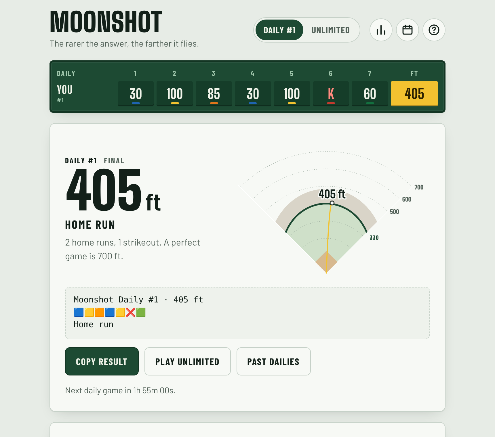

# Moonshot

A daily baseball trivia game with Krillion's structure and Immaculate Grid–style prompts. It has seven innings, each with one prompt and one answer. Name any MLB player who fits, but the rarer your correct answer, the farther it flies.


```
Moonshot Daily #1 · 485 ft
🟨🟩⬜🟦❌🟨🟧
Upper deck
```

## How it plays

| Result | Feet | Meaning |
| --- | ---: | --- |
| Bunt | 10 | Everybody's first thought |
| Too Cute | 15 | A "clever" pick that everybody else thought of too: Eddie Gaedel, Bo Jackson, Mike Piazza's 5 games as a Marlin, Brooks Robinson at shortstop |
| Single | 30 | Popular, but not the obvious one |
| Double | 60 | A real fan's answer |
| Triple | 85 | A deep cut |
| Home Run | 100 | Almost nobody names this one |
| Strikeout | 0 | Wrong player, a repeat, or the 30-second pitch clock ran out |

- **Seven prompts, one answer each,** on a 30-second pitch clock. Your total is your distance; 700 ft is a perfect game.
- **Daily:** everyone gets the same seven prompts, and a new game starts at local midnight (Daily #1 is Nov 18, 2026). Each prompt group is dealt from its own fixed shuffled queue, so no daily prompt repeats for about six months, no daily uses the same franchise twice, and difficulty ramps from easy to hard.
- **Unlimited:** fresh random games that skip prompts you've seen recently. You can focus on one **team** (all seven innings about the Mariners, say) or one **category** (franchises, teammates, honors, birthplaces, name games).
- **Hard mode:** no name suggestions; type the full name and press Enter. Misspellings aren't strikeouts, but the clock keeps running.
- **Autocomplete** covers all 23,000+ players. It shows position and years, and Jr./Sr. are spelled out (Ken Griffey Jr. vs. Sr.).
- **After each inning** you see your answer's rank, every franchise the player suited up for (the prompt's teams in bold), the most common answers, and the deep cuts you could have used.
- **Box score:** every valid answer for every prompt, filterable, plus a ballpark chart of your total distance and a shareable result.
- **Past dailies** can be replayed from the archive, and a daily left unfinished at midnight waits there. Stats (streak, average, best, a chart of recent distances, results by tier) stay in your browser.



## The bank

| | |
| --- | ---: |
| Prompts | **3,113** |
| Valid prompt–player answers | **531,812** |
| Players | **23,347** (AL/NL since 1876, the other recognized 19th-century majors and the 1914–15 Federal League, and the 1920–48 Negro Leagues) |
| Data through | 2025 season (Hall of Fame through the 2026 class) |

Prompt families:

- **Franchises:** played for a team, both of two teams (all 435 pairs), a team in a given decade or on its 2025 roster, a historical team (Brooklyn Dodgers, Montreal Expos, Seattle Pilots…), a pennant winner.
- **Franchise ×:** single-season feats with the team (30 HR, 20 W, .300, 30 SV…), league titles with the team, awards with the team, honors won anywhere (Immaculate Grid style: "Played for the Mets and won an MVP"), positions, birthplaces, career milestones, debut team, 10-season men, one-franchise lifers, managers who also played.
- **Clubhouse:** teammates of 145 stars, from Cy Young and Josh Gibson to Paul Skenes.
- **League-wide:** career milestones, single-season feats, league leaders and batting titles, awards (also by decade and by position), All-Stars (including with three franchises), Hall of Fame cuts, World Series and pennant heroics, 110-win and 110-loss teams.
- **Origins and oddities:** birth country, state, city, birth country × position ("Venezuelan-born shortstop"), holiday birthdays, height, handedness, all nine positions, debut classes, and name games (last name is an animal, color, food, job or president's name; alliteration; initials).

Franchise prompts count the whole franchise history: Expos seasons count for the Nationals, Brooklyn seasons for the Dodgers. Every prompt that touches a relocated franchise says so. "With the team" means the honor came while he played there; "and won" means with any team.

### Accuracy

- **Recognized leagues only.** Lahman also carries the 1871–75 National Association and pre-1920 independent Black clubs; MLB doesn't count either, so neither does Moonshot.
- **The modern World Series only,** so the 1884–90 "World's Series" and Negro World Series don't count. The All-Star Game is AL vs. NL; East–West games aren't included.
- **Rate-stat qualifiers use each team's real games played,** so Josh Gibson's .466 in 1943 counts as a .400 season. Saves count from 1969, when they became official.
- **`tests/test_data.py` runs about 22,000 checks** against known records: the exact 300-win and 3,000-hit clubs, Hall of Fame membership (Pete Rose and Shoeless Joe correctly out; Ichiro, Sabathia and the 2026 class in), birthplaces (Vladimir Guerrero Jr. was born in Canada), franchise history and more.

## How rarity works

Krillion ranks answers by how many players actually typed them. Moonshot has no crowd yet, so it estimates each answer's *pick share*:

1. **Fame** for every player comes from All-Star selections, MVP/Cy Young/ROY and other awards, the Hall of Fame, milestones and career totals, weighted toward recent players. Two short editorial lists cover what the box score can't see: icons (Ruth, Jackie Robinson, Ichiro, Ohtani…) and famous oddities (Eddie Gaedel, Moonlight Graham, Bo Jackson…).
2. **Association** measures how strongly a player belongs to the prompt: his share of career spent with the team (brief stints are penalized hard), whether he's among the franchise's all-time games leaders, his share of games at a position, the number of qualifying seasons, and how recent the feat was.
3. **A softmax over `fame / τ + γ·ln(association)`** gives each valid answer an estimated share of all fans' guesses. Tiers are cut from those shares (Bunt ≥ 3%, Single ≥ 0.8%, Double ≥ 0.2%, Triple ≥ 0.04%, else Home Run). Truly obscure players get a floor. Famous players on brief detours (a stint with a team, a cameo at a position) are rated **Too Cute**.

Prompts are kept only if a few answers are well known (so the prompt is answerable) and at least three are deep cuts (so a big hit is possible). The 500-HR club, for example, is out because everyone in it is famous.

## Running it

It's a static site, so open `index.html` or serve the folder:

```sh
python3 -m http.server 8765    # then visit http://localhost:8765
```

### Publishing on GitHub Pages

`.github/workflows/pages.yml` deploys the site on every push to `main`. One-time setup: **Settings → Pages → Build and deployment → Source: GitHub Actions**. Shared results include the Pages URL automatically. To use a different host, set `SHARE_URL` at the top of `assets/app.js`.

## Tests

```sh
python3 tests/test_build.py                 # unit tests for the pipeline helpers, no dependencies
python3 tests/test_data.py                  # fact checks on the answer bank, no dependencies
npm ci && npx playwright install chromium   # once
python3 -m http.server 8765 &
node tests/e2e.js http://localhost:8765/    # plays a full game in Chromium
```

The e2e test plays a daily game: right answers, a wrong one, and a timeout that survives a reload. It also checks that 120 dailies never repeat a prompt and that difficulty stays balanced, and it exercises search ranking, team and category focus, hard mode, the archive, midnight rollover, the stats chart, and a phone-width layout in dark mode. `.github/workflows/ci.yml` runs all three suites on every push.

## Rebuilding the data

```sh
pip install pylahman pyarrow
python3 tools/build_data.py            # writes data/moonshot-data.js
python3 tools/build_data.py --report   # plus a calibration report
```

Prompt templates, word lists, the icon and Too Cute lists, Jr./Sr. suffixes and the tier thresholds all live at the top of `tools/build_data.py`. Rebuilding changes the prompt set, which reshuffles the daily schedule, so rebuild between seasons rather than mid-season.

### Data format

`data/moonshot-data.js` sets `window.MOONSHOT_DATA`:

- `players[i]`: `[name, firstSeason, lastSeason, position]`, sorted by fame (autocomplete uses the order as a tiebreak).
- `spans[i]`: a player's stints with today's 30 franchises, 5 characters each: the franchise index, then the first and last season as `year − 1800` in two base64url characters.
- `prompts[]`: `{id, t: text, s: fine print, c: category, d: difficulty 1–3, tm: franchises, a: answers}`. `a` packs each answer as 3 base64url characters encoding `playerIndex × 8 + tier`, most common first.

## Files

```
index.html               page shell
assets/style.css         scoreboard look, light and dark themes
assets/app.js            game logic: schedule, pitch clock, search, scoring, sharing, stats
data/moonshot-data.js    generated prompt and answer bank
tools/build_data.py      data pipeline
tests/test_build.py      unit tests for the pipeline helpers
tests/test_data.py       fact checks on the bank
tests/e2e.js             browser test
docs/                    screenshots
```

## Credits

Player data comes from the [Lahman Baseball Database](https://sabr.org/lahman-database/) (SABR), licensed under [CC BY-SA 3.0](https://creativecommons.org/licenses/by-sa/3.0/), via the `pylahman` package. `data/moonshot-data.js` is derived from it and is shared under the same license.
